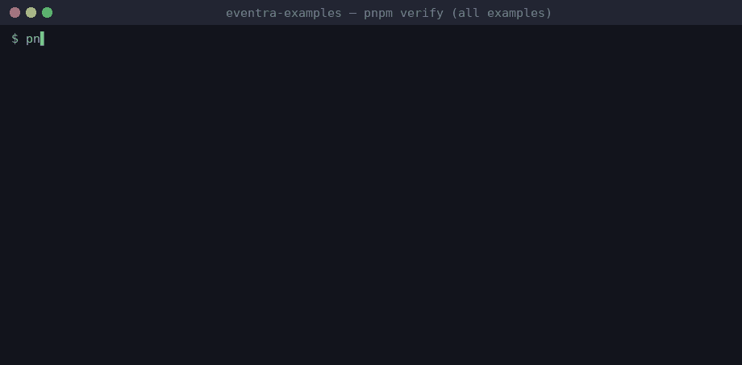
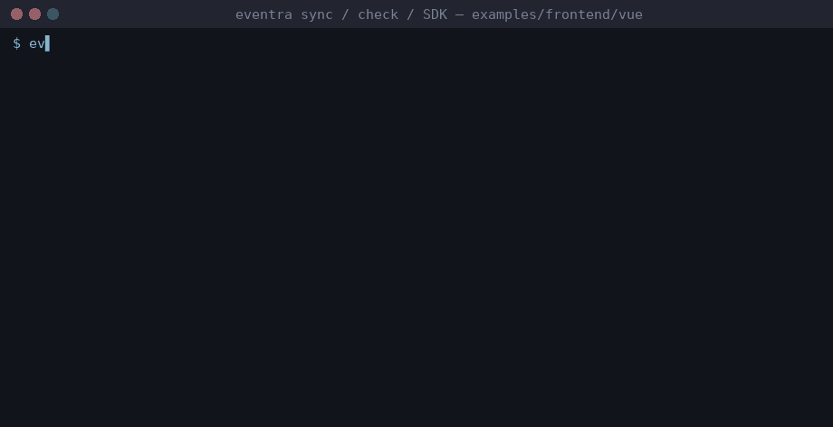

# Eventra Examples

Working examples and a test bench for the **Eventra SDK**, **CLI** and **framework plugins**: frontend, backend, edge runtimes and third-party analytics.



*`pnpm verify` across all examples, a real run. Every example also has its own `demo.gif`.*

[Packages](#packages) | [Quick start](#quick-start) | [Compatibility matrix](#compatibility-matrix) | [Demo](./docs/DEMO.md) | [Test results](./docs/TEST-RESULTS.md) | [Limitations](./docs/CLI-LIMITATIONS.md) | [Changelog](./CHANGELOG.md) | [Eventra docs](https://eventra.dev/docs)

---

## Packages

| Package | Version | Role |
|---|---|---|
| [`@eventra_dev/eventra-sdk`](https://www.npmjs.com/package/@eventra_dev/eventra-sdk) | **2.0.9** | Send events from browser, Node.js and edge runtimes — batching, retry, circuit breaker, idempotency |
| [`@eventra_dev/eventra-cli`](https://www.npmjs.com/package/@eventra_dev/eventra-cli) | **2.5.3** | Statically discover event names (`sync` / `check` / `watch` / `send`), cross-file wrappers, third-party `sinks` |
| [`@eventra_dev/cli-plugin-vue`](https://www.npmjs.com/package/@eventra_dev/cli-plugin-vue) | **1.2.5** | `.vue` SFCs (Vue, Nuxt) |
| [`@eventra_dev/cli-plugin-svelte`](https://www.npmjs.com/package/@eventra_dev/cli-plugin-svelte) | **1.2.5** | declarative `event="..."` in `.svelte` |
| [`@eventra_dev/cli-plugin-astro`](https://www.npmjs.com/package/@eventra_dev/cli-plugin-astro) | **1.2.4** | `.astro` frontmatter |
| [`@eventra_dev/cli-plugin-angular`](https://www.npmjs.com/package/@eventra_dev/cli-plugin-angular) | **1.2.4** | Angular templates (`[attr.event]`) |

## Quick start

```bash
pnpm install
export EVENTRA_API_KEY=test      # mock key — eventra.json files keep "apiKey": ""
pnpm dev:react                   # app :3000 + mock ingestion API :4000
```

```bash
cd examples/frontend/vue
pnpm exec eventra sync           # discover events -> eventra.json
pnpm exec eventra check          # exit 1 on drift (CI gate)
pnpm exec eventra watch          # live updates on save
```

Real output and a step-by-step Vue session: [docs/DEMO.md](./docs/DEMO.md).



## Compatibility matrix

| | CLI detection | Plugin needed | SDK runtime |
|---|---|---|---|
| [React](./examples/frontend/react) | native (incl. JSX `event=`) | — | yes |
| [Vue](./examples/frontend/vue) | yes | `cli-plugin-vue` | yes |
| [Nuxt](./examples/frontend/nuxt) | yes | `cli-plugin-vue` | yes |
| [Svelte](./examples/frontend/svelte) | JS calls native, `event=` via plugin | `cli-plugin-svelte` | yes |
| [Astro](./examples/frontend/astro) | yes | `cli-plugin-astro` | yes |
| [Angular](./examples/frontend/angular) | yes | `cli-plugin-angular` | yes |
| [Next.js](./examples/frontend/next) · [Vanilla](./examples/frontend/vanilla) | native | — | yes |
| [Node](./examples/backend/node) · [Express](./examples/backend/express) · [Fastify](./examples/backend/fastify) · [Hono](./examples/backend/hono) · [NestJS](./examples/backend/nestjs) | native | — | yes |
| [Cloudflare Workers](./examples/runtimes/cloudflare) · [Vercel](./examples/runtimes/vercel) | native | — | yes |
| [PostHog](./examples/analytics/posthog) · [Segment](./examples/analytics/segment) · [Amplitude](./examples/analytics/amplitude) · [GA4](./examples/analytics/ga4) | via `sinks` | — | uses your analytics SDK |

Dev scripts: `pnpm dev:<react|vue|nuxt|astro|svelte|vanilla|angular|next|node|express|fastify|hono|nest|vercel|posthog|segment|amplitude|ga4>`, `pnpm test:cf`.

## Tests

```bash
pnpm test:cli     # CLI scenarios (detection, send, watch, check…)
pnpm test:sdk     # SDK scenarios (batching, retry, circuit breaker…)
pnpm verify:cli   # sync + check + expected events across all 23 examples/fixtures (also in CI)
pnpm verify       # same + live SDK smoke against the mock server (local only: needs next/nest/workerd)
```

Plus headless-Chromium browser scenarios (`tools/sdk-feature-tests/browser-run.mjs`). Latest results and plugin coverage: [docs/TEST-RESULTS.md](./docs/TEST-RESULTS.md). CI runs `test:cli`, `test:sdk` and `verify:cli`; the full `verify` and the browser suite stay local.

## Repository layout

```
examples/{frontend,backend,runtimes,analytics}/   runnable apps, each with its own eventra.json
tools/cli-feature-tests · sdk-feature-tests       standalone diagnostic suites
tools/analytics-fixture-*                         adversarial call shapes for sinks
tools/mock-server                                 local ingestion + CLI endpoint (:4000)
docs/                                             demo, test results, research notes
```

## Further reading

- [docs/FINDINGS.md](./docs/FINDINGS.md) — per-plugin mechanics, anti-patterns, bugs found/fixed upstream, stress tests
- [docs/CLI-LIMITATIONS.md](./docs/CLI-LIMITATIONS.md) — what the CLI and plugins do not cover (with evidence level)
- [CHANGELOG.md](./CHANGELOG.md) · [docs/VERSIONS.md](./docs/VERSIONS.md) — release notes, per-version package pins, `pnpm use-version vX.Y.Z`
- [docs/TEST-RESULTS.md](./docs/TEST-RESULTS.md) — versions, matrix, open limitations
- [Eventra docs](https://eventra.dev/docs)

## License

MIT © 2026 Yuriy Korolik — see [LICENSE](./LICENSE).
