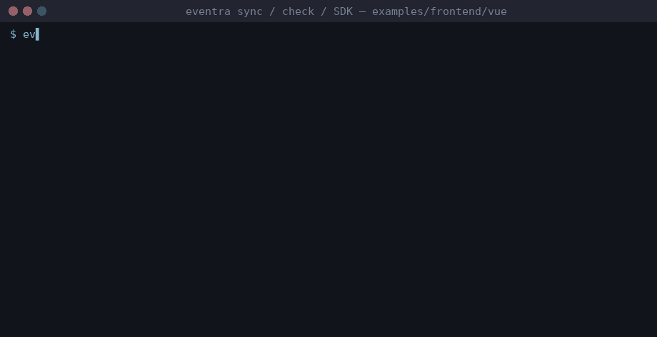

# Demo: what the CLI does



The GIF replays a real session (commands and output captured from actual runs on 2026-11-04, then rendered to frames). Flow: `sync` finds 14 events → add a `<TrackedButton>` → `sync` finds 15 → remove it → `check` exits 1 on the stale event → `sync && check` is green → SDK call reaches the mock server (`TRACK HIT`).

Real, unedited output captured on **eventra-cli 2.5.3 + cli-plugin-vue 1.2.5** (2026-11-04), from `examples/frontend/vue`:

```text
$ eventra sync
Scanning...
Found 14 events, 3 function wrappers

Dynamic event names:
~ src/components/TrackedButton.vue:7 trackFeature(...)
~ template of src/fixtures/DynamicEvents.vue: trackFeature(...)
~ template of src/fixtures/DynamicEvents.vue: event="unresolvedEvent"
~ src/tracker.ts:13 tracker.track(...)

$ eventra check
Checking events and function wrappers...

Dynamic event names:
~ src/components/TrackedButton.vue:7 trackFeature(...)
~ template of src/fixtures/DynamicEvents.vue: trackFeature(...)
~ template of src/fixtures/DynamicEvents.vue: event="unresolvedEvent"
~ src/tracker.ts:13 tracker.track(...)
All good
```

Notes:
- `sync` writes the discovered event list into `eventra.json`; `check` exits `1` on drift, so it works as a CI gate.
- The `~` lines are *dynamic* names (computed at runtime) — the CLI reports them instead of silently skipping.
- Run it yourself: `export EVENTRA_API_KEY=test && cd examples/frontend/vue && pnpm exec eventra sync`.

## Runtime path (SDK → mock ingestion)

```text
Component / route → trackFeature() → tracker.track()
                 → Eventra SDK → POST http://localhost:4000/track
```

`pnpm dev:mock` prints a `TRACK HIT` line for every received batch; `pnpm verify` asserts at least one hit per example.

## Re-record / live version (60 s)

1. `pnpm install && pnpm dev:vue` — app + mock server up.
2. In another terminal: `cd examples/frontend/vue && eventra watch`.
3. Add `<TrackedButton event="demo_new" />` to `App.vue` — `eventra.json` updates on save.
4. Click the button — `TRACK HIT` appears in the mock-server terminal.
5. `eventra check` → `All good`.
