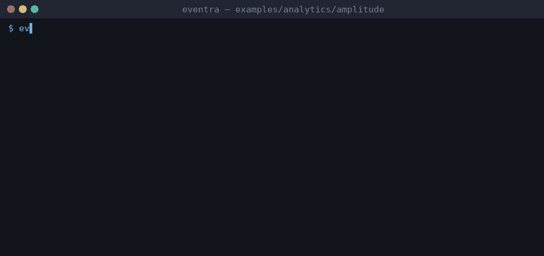

# Eventra + Amplitude (Express)


<sub>Real session on eventra-cli 2.6.0: `sync` and `check` read events through the analytics `sinks` preset.</sub>

An Express API using **@amplitude/analytics-node**: a `trackEvent` wrapper plus a direct `amplitude.track({ event_type })` call. Enabled in `eventra.json` through the `amplitude` preset:

```json
{ "sinks": [{ "preset": "amplitude" }] }
```

| File | Amplitude usage |
|------|-----------------|
| `src/lib/analytics.ts` | `amplitude.init`, `trackEvent()` wrapper |
| `src/lib/events.ts` | event names (spaces are fine: `Order Placed`) |
| `src/routes/*.ts` | wrapper calls with constants/literals + the object form |

```bash
pnpm dev:amplitude

cd examples/analytics/amplitude
export EVENTRA_API_KEY=test   # mock key; eventra.json keeps "apiKey": ""
eventra sync              # 4 events
eventra check
```

Browser SDK and legacy `amplitude-js` shapes are covered by the detector fixture in [`tools/analytics-fixture-amplitude`](../../../tools/analytics-fixture-amplitude).
