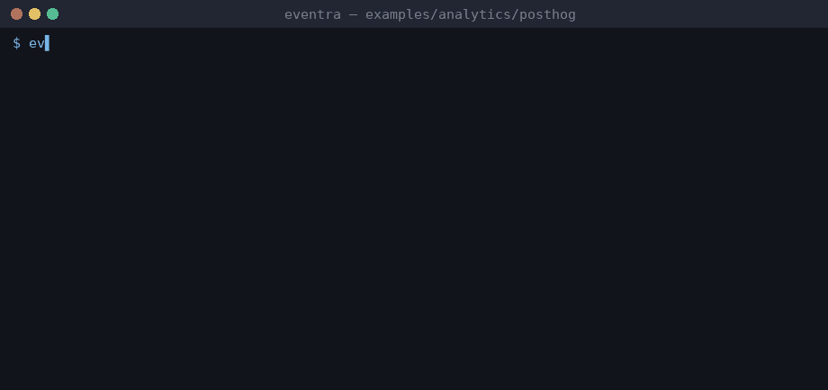

# Eventra + PostHog (Next.js)


<sub>Real session on eventra-cli 2.5.3: `sync` and `check` read events through the analytics `sinks` preset.</sub>

A small Next.js app using **posthog-js** (`PostHogProvider`, `usePostHog()`) in the browser and **posthog-node** in a route handler. The CLI reads PostHog events through the `posthog` preset in `eventra.json`:

```json
{ "sinks": [{ "preset": "posthog" }] }
```

| File | PostHog usage |
|------|---------------|
| `lib/events.ts` | event names as constants |
| `components/PricingCards.tsx` | `usePostHog()` + `posthog.capture(EVENTS.x)` |
| `app/api/checkout/route.ts` | posthog-node `capture({ distinctId, event })` |
| `app/providers.tsx` | `posthog.init`; `$pageview` is a system event and is ignored |

```bash
pnpm dev:posthog          # app on http://localhost:3000 (PostHog host points at the mock server)

cd examples/analytics/posthog
eventra init
eventra sync              # 4 events
eventra check
```

Every possible call shape, wrapper and edge case is covered by the detector fixture in [`tools/analytics-fixture-posthog`](../../../tools/analytics-fixture-posthog).
