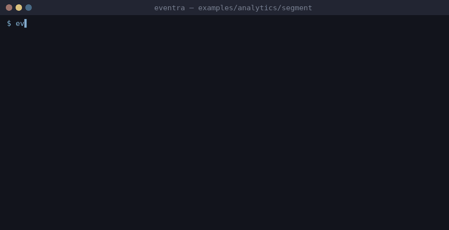

# Eventra + Segment (Vite + React)


<sub>Real session on eventra-cli 2.6.1: `sync` and `check` read events through the analytics `sinks` preset.</sub>

A Vite + React app using **@segment/analytics-next**: one shared `AnalyticsBrowser.load(...)` client, a thin `trackEvent` wrapper, and a couple of direct `analytics.track(...)` calls. Enabled in `eventra.json` through the `segment` preset:

```json
{ "sinks": [{ "preset": "segment" }] }
```

| File | Segment usage |
|------|---------------|
| `src/lib/analytics.ts` | `AnalyticsBrowser.load()` client and the `trackEvent()` wrapper |
| `src/lib/events.ts` | event names (spaces are fine: `Signed Up`) |
| `src/components/*.tsx` | wrapper calls with constants + a direct `analytics.track("Docs Opened")`; `identify` and `page` are not events |

```bash
pnpm dev:segment

cd examples/analytics/segment
export EVENTRA_API_KEY=test   # mock key; eventra.json keeps "apiKey": ""
eventra sync              # 4 events
eventra check
```

Every call shape and edge case is covered by the detector fixture in [`tools/analytics-fixture-segment`](../../../tools/analytics-fixture-segment).
