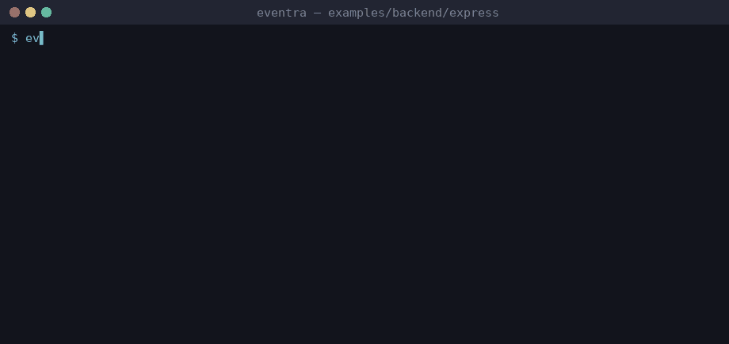

# Eventra + Express


<sub>Real session on eventra-cli 2.6.0 / eventra-sdk 2.0.9: `sync`, `check`, detected events, and an SDK call reaching the mock server.</sub>

Express + **Eventra SDK** + **Eventra CLI**.

Backend code is plain TypeScript — **full CLI support** (no SFC). See [root README](../../../README.md#frameworks-without-cli-support) for Vue/Svelte/Nuxt patterns.

---

## Project structure

```
express/
├── eventra.json
├── services/tracker.ts
├── middleware/tracking.middleware.ts
└── routes/index.ts
```

---

## Run

```bash
pnpm dev:express
```

| Service | URL |
|---------|-----|
| Server | http://localhost:3000 |
| SDK | http://localhost:4000/track |

---

## Eventra CLI

```bash
cd examples/backend/express
export EVENTRA_API_KEY=test   # mock key; eventra.json keeps "apiKey": ""
eventra sync                  # discover events and write them to eventra.json
eventra check                 # exit code 1 on drift (CI gate)
```

**Detected events:** `express_home`, `express_request`

---

## Docs

https://eventra.dev/docs
