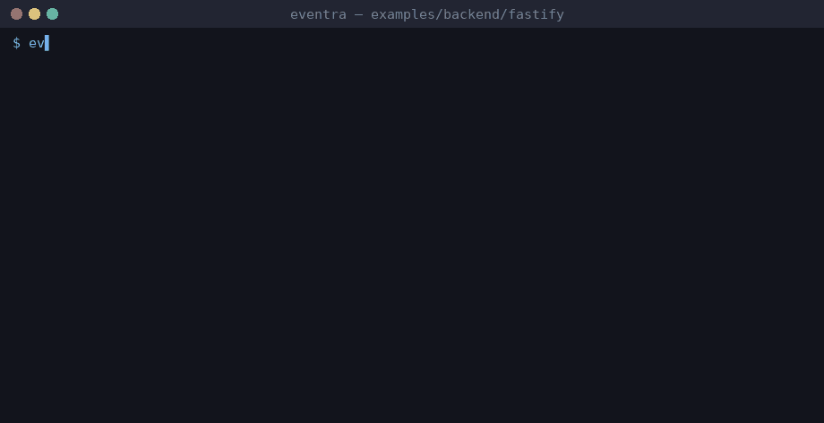

# Eventra + Fastify


<sub>Real session on eventra-cli 2.5.3 / eventra-sdk 2.0.9: `sync`, `check`, detected events, and an SDK call reaching the mock server.</sub>

Fastify + **Eventra SDK** + **Eventra CLI**.

TypeScript-only — use **static imports** in `app.ts` so CLI follows the plugin graph (dynamic `import()` is not tracked).

---

## Project structure

```
fastify/
├── eventra.json
└── src/
    ├── app.ts
    ├── services/tracker.ts
    ├── plugins/tracking.plugin.ts
    └── routes/index.ts
```

---

## Run

```bash
pnpm dev:fastify
```

| Service | URL |
|---------|-----|
| Server | http://localhost:3000 |
| SDK | http://localhost:4000/track |

---

## Eventra CLI

```bash
cd examples/backend/fastify
eventra init
eventra sync
```

**Detected events:** `fastify_request`, `fastify_response`, `fastify_home`

---

## Docs

https://eventra.dev/docs
