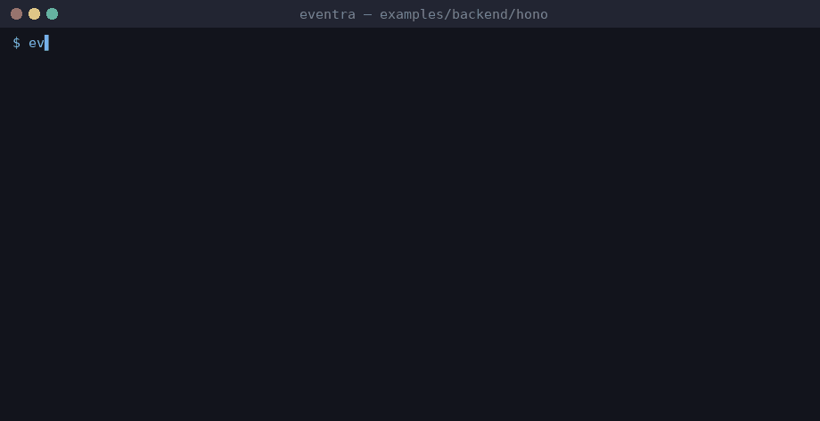

# Eventra + Hono


<sub>Real session on eventra-cli 2.5.3 / eventra-sdk 2.0.9: `sync`, `check`, detected events, and an SDK call reaching the mock server.</sub>

Hono + **Eventra SDK** + **Eventra CLI**.

Plain TypeScript — full CLI support.

---

## Project structure

```
hono/
├── eventra.json
├── services/tracker.ts
├── middleware/tracking.middleware.ts
└── routes/index.ts
```

---

## Run

```bash
pnpm dev:hono
```

| Service | URL |
|---------|-----|
| Server | http://localhost:3000 |
| SDK | http://localhost:4000/track |

---

## Eventra CLI

```bash
cd examples/backend/hono
eventra init
eventra sync
```

**Detected events:** `hono_request`, `hono_response`, `hono_home`

---

## Docs

https://eventra.dev/docs
