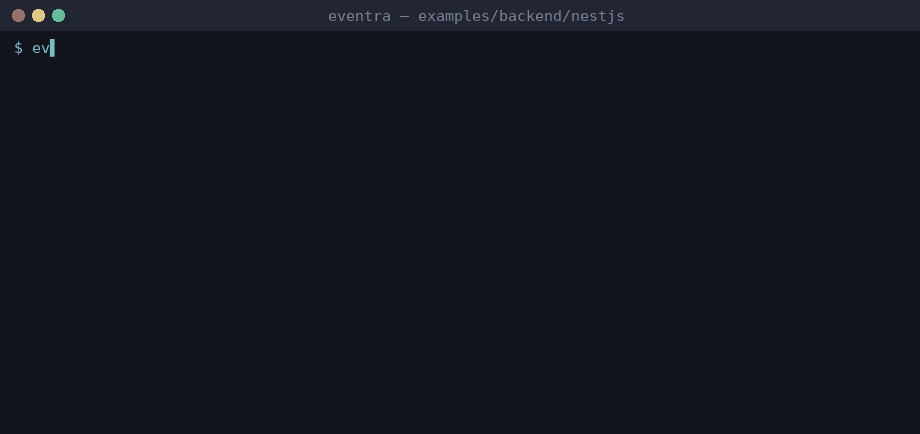

# Eventra + NestJS


<sub>Real session on eventra-cli 2.6.1 / eventra-sdk 2.0.9: `sync`, `check`, detected events, and an SDK call reaching the mock server.</sub>

NestJS + **Eventra SDK** + **Eventra CLI**.

Tracking in `.ts` via `TrackerService` and interceptor — CLI resolves `this.tracker.track()` through the service layer.

---

## Project structure

```
nestjs/
├── eventra.json
└── src/tracker/
    ├── tracker.service.ts
    └── tracking.interceptor.ts
```

---

## Run

```bash
pnpm dev:nest
```

| Service | URL |
|---------|-----|
| Server | http://localhost:3000 |
| SDK | http://localhost:4000/track |

---

## Eventra CLI

```bash
cd examples/backend/nestjs
export EVENTRA_API_KEY=test   # mock key; eventra.json keeps "apiKey": ""
eventra sync                  # discover events and write them to eventra.json
eventra check                 # exit code 1 on drift (CI gate)
```

**Detected events:** `nestjs_home`, `nestjs_request`, `nestjs_response`

---

## Docs

https://eventra.dev/docs
