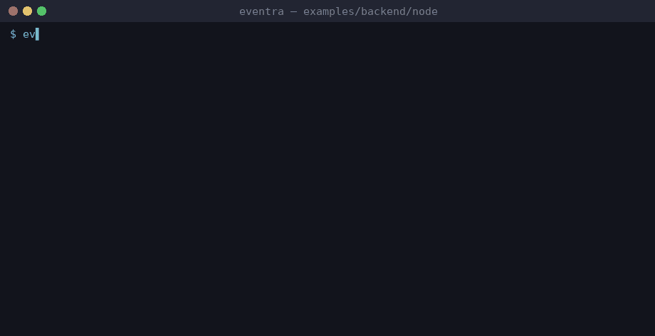

# Eventra + Node.js


<sub>Real session on eventra-cli 2.6.1 / eventra-sdk 2.0.9: `sync`, `check`, detected events, and an SDK call reaching the mock server.</sub>

Minimal Node.js + **Eventra SDK** + **Eventra CLI**.

All tracking in `.ts` files — native CLI support.

---

## Project structure

```
node/
├── eventra.json
└── src/
    ├── tracker.ts
    └── index.ts
```

---

## Run

```bash
pnpm dev:node
```

SDK: http://localhost:4000/track

---

## Eventra CLI

```bash
cd examples/backend/node
export EVENTRA_API_KEY=test   # mock key; eventra.json keeps "apiKey": ""
eventra sync                  # discover events and write them to eventra.json
eventra check                 # exit code 1 on drift (CI gate)
```

**Detected events:** `node_started`

---

## Docs

https://eventra.dev/docs
