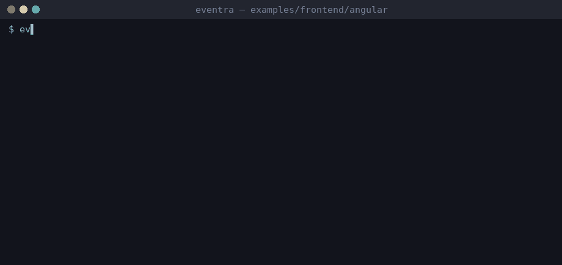

# Eventra + Angular


<sub>Real session on eventra-cli 2.6.8 / eventra-sdk 2.0.13: `sync`, `check`, detected events, and an SDK call reaching the mock server.</sub>

Angular (CLI) + **Eventra SDK** + **Eventra CLI**.

---

## CLI and Angular

Component file is `.ts` (scannable), but **event literals** live in `src/app/events.ts` so tracking logic is not mixed with templates.

| File | Role |
|------|------|
| `src/app/events.ts` | `tracker.track("…")` literals |
| `src/app/app.component.ts` | Calls `trackAngularPageView()` / `trackAngularClick()` |

Uses direct SDK `track()` (no `trackFeature` wrapper).

---

## Project structure

```
angular/
├── eventra.json
└── src/app/
    ├── events.ts
    └── app.component.ts
```

---

## Run

```bash
pnpm dev:angular
```

| Service | URL |
|---------|-----|
| App | http://localhost:3000 |
| SDK | http://localhost:4000/track |

---

## Eventra CLI

```bash
cd examples/frontend/angular
export EVENTRA_API_KEY=test   # mock key; eventra.json keeps "apiKey": ""
eventra sync                  # discover events and write them to eventra.json
eventra check                 # exit code 1 on drift (CI gate)
```

**Detected events:** `angular_click`, `angular_control_flow_else_click`, `angular_control_flow_if_click`, `angular_dynamic_field_click`, `angular_dynamic_getter_click`, `angular_ngif_click`, `angular_page_view`, `angular_template_literal_click`

---

## Docs

https://eventra.dev/docs
