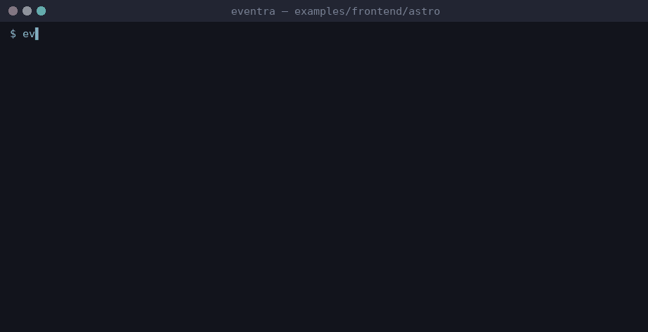

# Eventra + Astro


<sub>Real session on eventra-cli 2.6.0 / eventra-sdk 2.0.9: `sync`, `check`, detected events, and an SDK call reaching the mock server.</sub>

Astro + **Eventra SDK** + **Eventra CLI** + **@eventra_dev/cli-plugin-astro**.

---

## CLI and Astro

`@eventra_dev/cli-plugin-astro` parses the **frontmatter fence** (`---`) of `.astro` files with the real Astro compiler — required, not optional: a `trackFeature(...)` call there is only picked up by `sync` with the plugin registered (verified live via A/B test — see the root README's [Svelte & Astro via CLI plugins](../../../README.md#svelte--astro-via-cli-plugins) section).

| Path | Detected? |
|------|-----------|
| `trackFeature(...)` in the frontmatter fence | Yes, with the plugin |
| Declarative `event="..."` / `event={expr}` / `{event}` shorthand template attribute — any tag, including inside `{cond && <div event="...">}` and `.map()` | Yes, with the plugin |
| `trackFeature(...)` inside a `<script>` tag in the file's **body markup** (not the frontmatter) | **Scanned since `cli-plugin-astro@1.3.0`** (verified); up to 1.2.x it was unscanned, same as plain `.html` |

One documentation gap found and **fixed upstream in `cli-plugin-astro@1.0.1`**: an earlier README revision showed `` event=`a-${b}` `` (no braces) as valid interpolation syntax, but it was silently ignored as written — the working form needs braces: `` event={`a-${b}`} ``. The plugin's README now documents this explicitly as unsupported-by-design; both forms are still exercised live in this example (see `astro_interp_z`, resolved via the braced form).

| File | Role |
|------|------|
| `src/lib/tracker.ts` | SDK instance + `trackFeature()` wrapper |
| `src/events.ts` | Event literals for the "centralize in `.ts`" convention |
| `src/client.ts` | Browser entry — imports from `events.ts`, used by the body `<script>` path (body scripts are scanned since plugin 1.3.0, so this indirection is no longer required) |
| `src/pages/index.astro` | Frontmatter direct call + the full `event="..."` template-attribute matrix (literal, dynamic, shorthand, conditional, `.map()`, edge cases) |

---

## Project structure

```
astro/
├── eventra.json
└── src/
    ├── lib/tracker.ts
    ├── events.ts
    ├── client.ts
    └── pages/
        └── index.astro
```

---

## Run

```bash
pnpm dev:astro
```

| Service | URL |
|---------|-----|
| App | http://localhost:3000 |
| SDK | http://localhost:4000/track |

---

## Eventra CLI

```json
{
  "plugins": ["@eventra_dev/cli-plugin-astro"]
}
```

```bash
cd examples/frontend/astro
export EVENTRA_API_KEY=test   # mock key; eventra.json keeps "apiKey": ""
eventra sync                  # discover events and write them to eventra.json
eventra check                 # exit code 1 on drift (CI gate)
```

**Detected events:** `astro_button_click`, `astro_click`, `astro_conditional_click`, `astro_dynamic_resolved`, `astro_frontmatter_view`, `astro_interp_z`, `astro_map_item_click`, `astro_page_view`, `astro_shorthand_event`

---

## Docs

https://eventra.dev/docs
