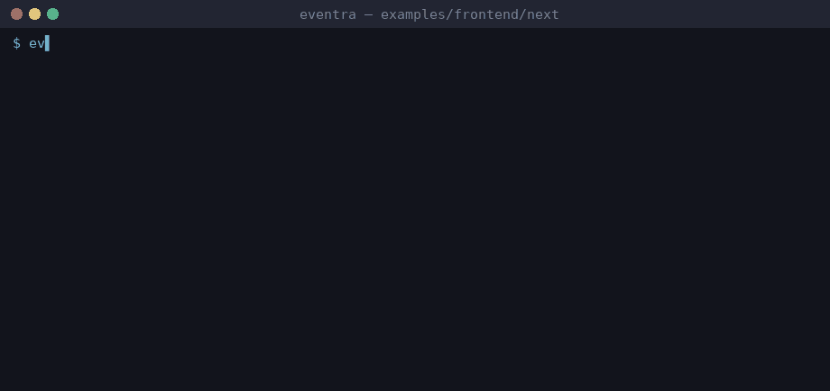

# Eventra + Next.js


<sub>Real session on eventra-cli 2.5.3 / eventra-sdk 2.0.9: `sync`, `check`, detected events, and an SDK call reaching the mock server.</sub>

Next.js App Router + **Eventra SDK** + **Eventra CLI**.

---

## CLI and Next.js

`app/page.tsx` is scannable (`.tsx`), but event literals are centralized in `lib/events.ts` — recommended for any App Router project.

| File | Role |
|------|------|
| `lib/events.ts` | Event literals — **primary CLI source** |
| `lib/tracker.ts` | SDK + `trackFeature()` |
| `app/page.tsx` | Client component — calls helpers only |

---

## Project structure

```
next/
├── eventra.json
├── lib/
│   ├── tracker.ts
│   └── events.ts
└── app/page.tsx
```

---

## Run

```bash
pnpm dev:next
```

| Service | URL |
|---------|-----|
| App | http://localhost:3000 |
| SDK | http://localhost:4000/track |

---

## Eventra CLI

```bash
cd examples/frontend/next
export EVENTRA_API_KEY=test   # mock key; eventra.json keeps "apiKey": ""
eventra sync                  # discover events and write them to eventra.json
eventra check                 # exit code 1 on drift (CI gate)
```

**Detected events:** `next_click`, `next_page_view`

---

## Docs

https://eventra.dev/docs
