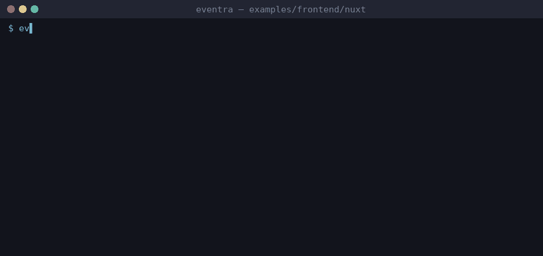

# Eventra + Nuxt


<sub>Real session on eventra-cli 2.6.1 / eventra-sdk 2.0.9: `sync`, `check`, detected events, and an SDK call reaching the mock server.</sub>

Nuxt 3 + **Eventra SDK** + **Eventra CLI** + **@eventra_dev/cli-plugin-vue**.

---

## CLI and Nuxt

Nuxt pages/layouts/components are ordinary `.vue` SFCs, so `@eventra_dev/cli-plugin-vue` parses them the same way it parses standalone Vue components — no extra config beyond listing the plugin.

| File | Role |
|------|------|
| `utils/tracker.ts` | SDK instance + `trackFeature()` wrapper — auto-imported project-wide by Nuxt |
| `pages/index.vue` | Calls `trackFeature("nuxt_page_view")` directly in `<script setup>`; tracks clicks declaratively via `event="…"` |
| `pages/auto-import.vue` | Calls `trackFeature("nuxt_auto_import_click")` with **no explicit import at all** — resolved purely through Nuxt's auto-import |
| `components/TrackedButton.vue` | Generic button that fires whatever `event` prop it's given |

**Detection sources exercised here:**

- Direct wrapper call in `<script setup>` → `trackFeature("nuxt_page_view")`
- Literal template attribute → `<TrackedButton event="nuxt_click">`
- Dynamic template attribute resolved through script scope → `<TrackedButton :event="DYNAMIC_FEATURE">`
- **Nuxt auto-import, confirmed end-to-end**: `trackFeature()` resolved with zero explicit `import` statement, via the real generated `.nuxt/imports.d.ts`. This requires `tsconfig.json` to `extend` `./.nuxt/tsconfig.json` (already wired in this example) — without it, `eventra sync` cannot see Nuxt's ambient auto-import types and silently misses the call. `.nuxt/` is generated automatically by `nuxt prepare` on `pnpm install` (postinstall); run `pnpm exec nuxt prepare` manually if it is missing.

---

## Project structure

```
nuxt/
├── eventra.json
├── tsconfig.json      # extends ./.nuxt/tsconfig.json — required for auto-import resolution
├── utils/
│   └── tracker.ts
├── components/
│   └── TrackedButton.vue
└── pages/
    ├── index.vue
    └── auto-import.vue
```

---

## Run

```bash
pnpm dev:nuxt
```

| Service | URL |
|---------|-----|
| App | http://localhost:3000 |
| SDK | http://localhost:4000/track |

---

## Eventra CLI

```json
{
  "plugins": ["@eventra_dev/cli-plugin-vue"]
}
```

```bash
cd examples/frontend/nuxt
export EVENTRA_API_KEY=test   # mock key; eventra.json keeps "apiKey": ""
eventra sync                  # discover events and write them to eventra.json
eventra check                 # exit code 1 on drift (CI gate)
```

**Detected events:** `nuxt_auto_import_click`, `nuxt_click`, `nuxt_dynamic_feature`, `nuxt_page_view`

---

## Docs

https://eventra.dev/docs
