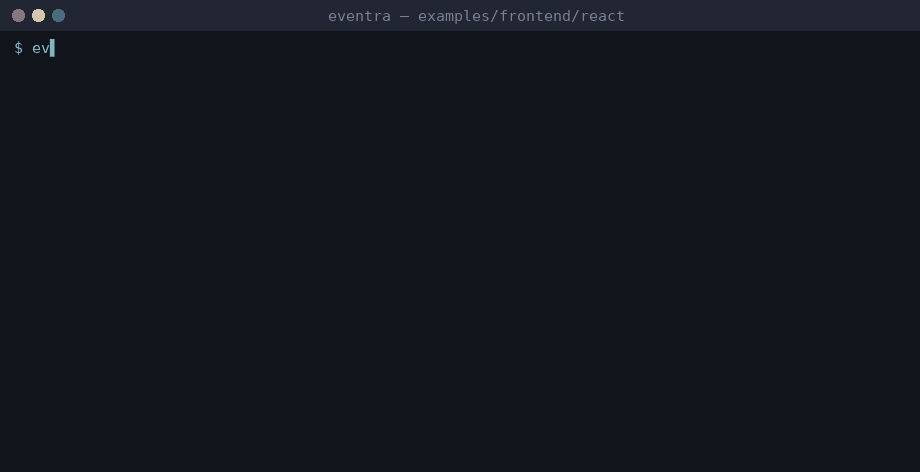

# Eventra + React


<sub>Real session on eventra-cli 2.6.0 / eventra-sdk 2.0.9: `sync`, `check`, detected events, and an SDK call reaching the mock server.</sub>

React (Vite) + **Eventra SDK** + **Eventra CLI**.

---

## CLI and React

`.tsx` files **are** scanned, but this example keeps **all event name literals** in `src/events.ts` so the list stays in one place (same pattern as Vue/Svelte).

| File | Role |
|------|------|
| `src/events.ts` | Literals + `trackReactPageView()` / `trackReactClick()` |
| `src/tracker.ts` | SDK + `trackFeature()` |
| `src/App.tsx` | UI — no `"event_name"` strings |

---

## Project structure

```
react/
├── eventra.json
└── src/
    ├── tracker.ts
    ├── events.ts
    └── App.tsx
```

---

## Run

```bash
pnpm dev:react
```

| Service | URL |
|---------|-----|
| App | http://localhost:3000 |
| SDK | http://localhost:4000/track |

---

## Eventra CLI

```bash
cd examples/frontend/react
export EVENTRA_API_KEY=test   # mock key; eventra.json keeps "apiKey": ""
eventra sync                  # discover events and write them to eventra.json
eventra check                 # exit code 1 on drift (CI gate)
```

**Detected events:** `check_mode`, `new_event`, `react_click`, `react_click_enum`, `react_jsx_attr_click`, `react_jsx_dynamic_attr_click`, `react_page_view`

---

## Docs

https://eventra.dev/docs
