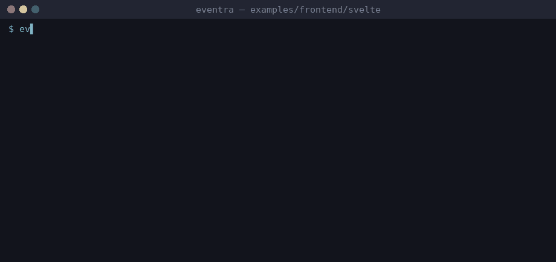

# Eventra + Svelte


<sub>Real session on eventra-cli 2.6.8 / eventra-sdk 2.0.13: `sync`, `check`, detected events, and an SDK call reaching the mock server.</sub>

Svelte (Vite) + **Eventra SDK** + **Eventra CLI** + **@eventra_dev/cli-plugin-svelte**.

---

## CLI and Svelte

Two independent detection paths, verified live (see the root README's [Svelte & Astro via CLI plugins](../../../README.md#svelte--astro-via-cli-plugins) section for the full A/B test):

| Path | Needs the plugin? | Example in this repo |
|------|--------------------|-----------------------|
| Plain `track()`/`trackFeature()` **JS calls** in `<script>` or inline in the markup | No — `eventra-cli@2.0.7` scans `.svelte` files natively | `trackSveltePageView()` in `App.svelte`'s `<script>`; `trackFeature("svelte_direct_click")`; `on:click={() => trackFeature("svelte_inline_markup_click")}` |
| Declarative **`event="..."` template attribute** (same convention as Vue's `TrackedButton`) | **Yes** — this is genuinely plugin-exclusive | `<button event="svelte_button_click">`, plus one inside every Svelte block type: `{#if}/{:else if}/{:else}`, `{#each}`, `{#await}/{:then}/{:catch}`, `{#key}`, `<slot>` |

Since `cli-plugin-svelte@1.3.0` the interpolated string form `event="a-{b}"` (found here as `a-y`) and the `{event}` shorthand (found as `svelte_shorthand_attr_click`) are both read, closing the gap this plugin had compared with `cli-plugin-astro` up to 1.2.x.

| File | Role |
|------|------|
| `src/lib/tracker.ts` | SDK instance + `trackFeature()` wrapper |
| `src/lib/events.ts` | Event literals for the "centralize in `.ts`" convention — **CLI reads this either way** |
| `src/App.svelte` | Exercises both detection paths above |

---

## Project structure

```
svelte/
├── eventra.json
└── src/
    ├── lib/tracker.ts
    ├── lib/events.ts
    └── App.svelte
```

---

## Run

```bash
pnpm dev:svelte
```

| Service | URL |
|---------|-----|
| App | http://localhost:3000 |
| SDK | http://localhost:4000/track |

---

## Eventra CLI

```json
{
  "plugins": ["@eventra_dev/cli-plugin-svelte"]
}
```

```bash
cd examples/frontend/svelte
export EVENTRA_API_KEY=test   # mock key; eventra.json keeps "apiKey": ""
eventra sync                  # discover events and write them to eventra.json
eventra check                 # exit code 1 on drift (CI gate)
```

**Detected events:** `a-y`, `svelte_await_catch_click`, `svelte_await_pending_click`, `svelte_await_then_click`, `svelte_button_click`, `svelte_click`, `svelte_direct_click`, `svelte_dynamic_attr_resolved`, `svelte_each_click`, `svelte_else_click`, `svelte_elseif_click`, `svelte_if_click`, `svelte_inline_markup_click`, `svelte_key_click`, `svelte_page_view`, `svelte_shorthand_attr_click`, `svelte_slot_default_click`

---

## Docs

https://eventra.dev/docs
