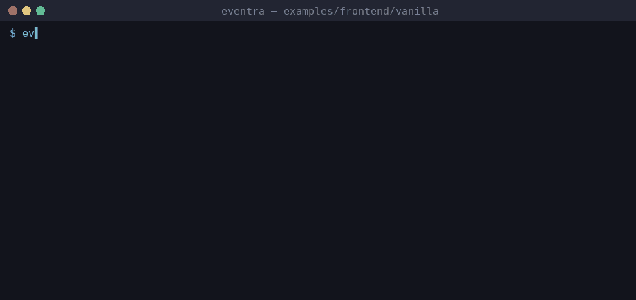

# Eventra + Vanilla (TypeScript)


<sub>Real session on eventra-cli 2.6.0 / eventra-sdk 2.0.9: `sync`, `check`, detected events, and an SDK call reaching the mock server.</sub>

TypeScript + Vite, no UI framework — **Eventra SDK** + **Eventra CLI**.

---

## CLI and Vanilla

All code is plain `.ts` — **full CLI support**, no SFC workarounds.

| File | Role |
|------|------|
| `src/events.ts` | Event literals |
| `src/tracker.ts` | SDK + `trackFeature()` |
| `src/client.ts` | DOM wiring |

Use `@eventra_dev/eventra-sdk` npm import (not CDN) so static analysis resolves the SDK.

---

## Project structure

```
vanilla/
├── eventra.json
├── index.html
└── src/
    ├── tracker.ts
    ├── events.ts
    └── client.ts
```

---

## Run

```bash
pnpm dev:vanilla
```

| Service | URL |
|---------|-----|
| App | http://localhost:3000 |
| SDK | http://localhost:4000/track |

---

## Eventra CLI

```bash
cd examples/frontend/vanilla
export EVENTRA_API_KEY=test   # mock key; eventra.json keeps "apiKey": ""
eventra sync                  # discover events and write them to eventra.json
eventra check                 # exit code 1 on drift (CI gate)
```

**Detected events:** `vanilla_click`, `vanilla_page_view`

---

## Docs

https://eventra.dev/docs
