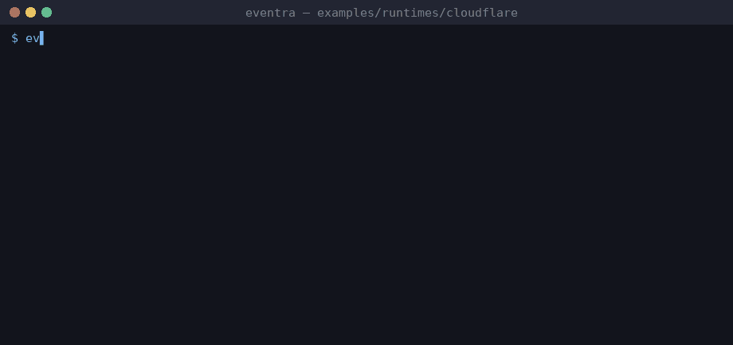

# Eventra + Cloudflare Workers


<sub>Real session on eventra-cli 2.6.1 / eventra-sdk 2.0.9: `sync`, `check`, detected events, and an SDK call reaching the mock server.</sub>

Cloudflare Workers + **Eventra SDK** + **Eventra CLI**.

Edge worker — all events in `src/*.ts` (no framework SFC).

---

## Project structure

```
cloudflare/
├── eventra.json
└── src/
    ├── index.ts
    └── test.ts
```

---

## Run

```bash
pnpm test:cf
```

SDK: http://localhost:4000/track

---

## Eventra CLI

```bash
cd examples/runtimes/cloudflare
export EVENTRA_API_KEY=test   # mock key; eventra.json keeps "apiKey": ""
eventra sync                  # discover events and write them to eventra.json
eventra check                 # exit code 1 on drift (CI gate)
```

**Detected events:** `cloudflare_after_timeout`, `cloudflare_request`, `cloudflare_test`

---

## Docs

https://eventra.dev/docs
