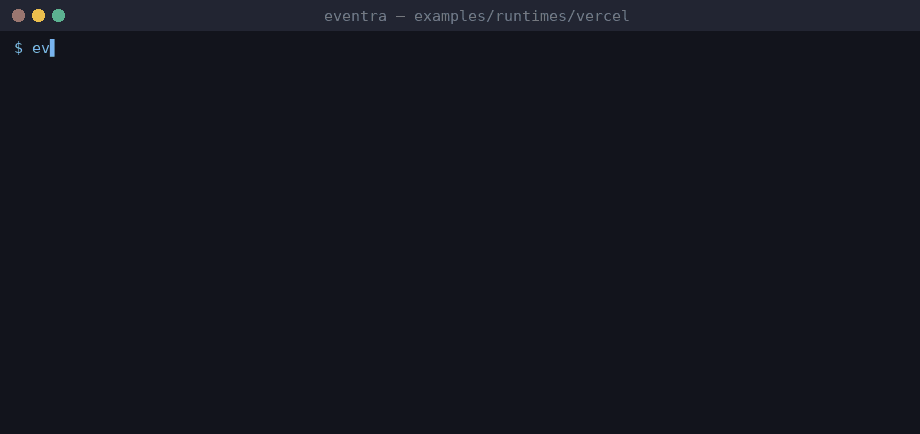

# Eventra + Vercel Edge


<sub>Real session on eventra-cli 2.6.1 / eventra-sdk 2.0.9: `sync`, `check`, detected events, and an SDK call reaching the mock server.</sub>

Vercel Edge (Next.js API route) + **Eventra SDK** + **Eventra CLI**.

Events in `app/api/track/route.ts` — plain TypeScript, full CLI support.

For App Router pages with `.vue`/`.tsx` UI, see [root README](../../../README.md#frameworks-without-cli-support).

---

## Project structure

```
vercel/
├── eventra.json
└── app/api/track/route.ts
```

---

## Run

```bash
pnpm dev:vercel
```

| Service | URL |
|---------|-----|
| App | http://localhost:3000 |
| SDK | http://localhost:4000/track |

---

## Eventra CLI

```bash
cd examples/runtimes/vercel
export EVENTRA_API_KEY=test   # mock key; eventra.json keeps "apiKey": ""
eventra sync                  # discover events and write them to eventra.json
eventra check                 # exit code 1 on drift (CI gate)
```

**Detected events:** `vercel_api_hit`, `vercel_request`

---

## Docs

https://eventra.dev/docs
